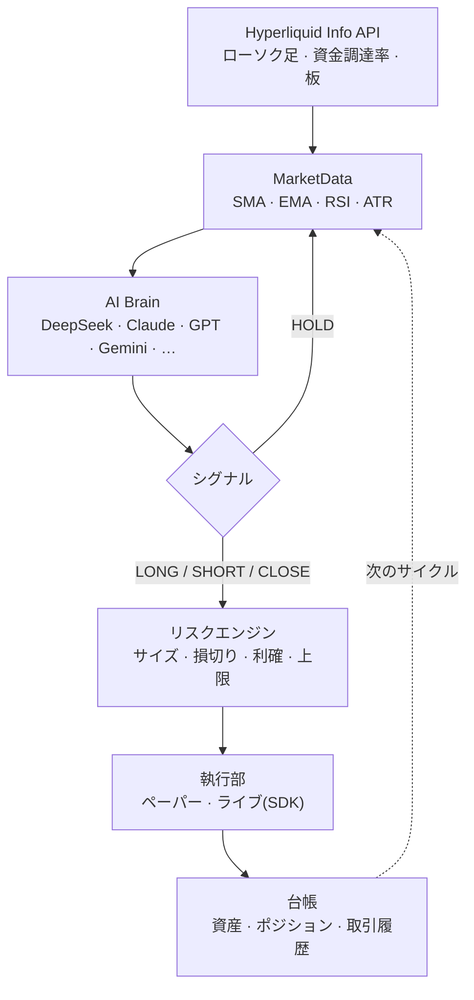
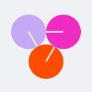
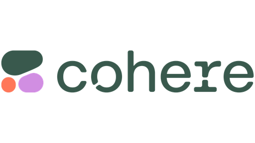
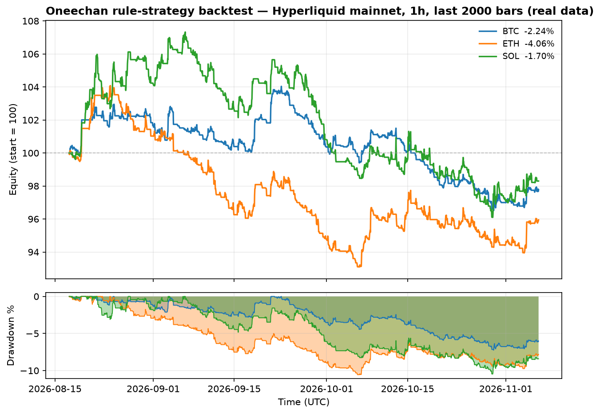

<p align="center">
  
</p>

<h1 align="center">Oneechan</h1>

<p align="center">
  <strong>Hyperliquid L1 向け AI トレーディングエージェント</strong><br>
  DeepSeek · Claude · GPT · Gemini · その他 —— 市場を読み、ポジションを計算し、注文を執行。<br>
  ペーパー取引ファースト · マルチプロバイダー · 実データでバックテスト済み。
</p>

<p align="center">
  <a href="https://oneechan.si"></a>
  <a href="https://x.com/oneechansi"></a>
  <a href="./LICENSE"></a>
  
  
  
</p>

<p align="center">
  <a href="README.md">English</a> · <a href="README.zh-CN.md">简体中文</a> · <b>日本語</b>
</p>

---

## Oneechan とは？

Oneechan は [Hyperliquid L1](https://hyperliquid.xyz) 上で動作する **AI パーペチュアル先物
トレーディングエージェント**です。各サイクルで以下を行います：

1. オンチェーンのリアルタイム市場データ（ローソク足・資金調達率・板）を取得し、
2. LLM —— **DeepSeek、Claude、GPT、Gemini、その他 9 プロバイダー** —— にデータを渡して
   推論させ、構造化された `LONG / SHORT / CLOSE / HOLD` シグナルを返させます、
3. **リスクエンジン**でポジションサイズを計算し（損失許容額・最大想定元本・最大レバレッジで制限）、
4. 公式 Hyperliquid SDK で執行します —— デフォルトは**ペーパー取引（シミュレーション）**で、
   明示的に指定した場合のみ実注文を出します。

さらに、実際の Hyperliquid ローソク足で戦略を検証できる**バックテスト基盤**も同梱しています。

> ⚠️ Oneechan は教育用ソフトウェアであり、投資助言ではありません。また**100% 勝てる戦略は
> 存在しません**（[バックテスト](#バックテスト)と[免責事項](#免責事項)を参照）。

---

## 仕組み



| 段階 | 内容 |
| --- | --- |
| **MarketData** | Hyperliquid `Info` API をラップし、SMA/EMA/RSI/ATR と板の偏りを計算。読み取りのみ・キー不要。 |
| **Brain** | 設定した LLM にコンパクトなコンテキストを送り、厳密な JSON 判定をパース。不正な結果は `HOLD` 扱い。 |
| **Risk** | シグナルを具体的なサイズに変換。`risk_per_trade_pct` 分を損切りまでに賭け、最大想定元本・最大レバレッジで制限。 |
| **Executor** | ペーパーは中間価格＋手数料で約定を模擬。ライブは **API ウォレット**（取引のみ・出金不可）で実注文に署名。 |
| **Ledger** | 各サイクルで資産・ポジション・取引履歴を永続化。 |

---

## 特徴

- **マルチプロバイダー AI** —— 単一インターフェースで 14 プロバイダー（DeepSeek、Claude、GPT、
  Gemini、OpenRouter、Groq、xAI、Together、Mistral、Perplexity、Cohere、Fireworks、Cerebras、Qwen）。
- **ペーパー取引ファースト** —— そのまま完全シミュレーション。キー不要。
- **ライブ取引** —— `--mode live` で Hyperliquid テストネット／メインネットに実注文。
- **リスク管理** —— 信頼度に応じたサイジング、損切り/利確、最大想定元本、最大レバレッジ、銘柄別クールダウン。
- **バックテスト** —— 実ローソク足で戦略を再生し、正直な指標を出力。
- **複数銘柄** —— 任意の Hyperliquid パーペチュアルを監視（BTC、ETH、SOL …）。
- **軽量** —— Hyperliquid SDK・`openai`・`anthropic`・`eth-account`・`PyYAML`・`python-dotenv` のみ。

---

## クイックスタート

```bash
git clone https://github.com/jepspows/oneechan.git
cd oneechan

python -m venv .venv
source .venv/bin/activate          # Windows: .venv\Scripts\activate
pip install -r requirements.txt

cp .env.example .env               # 任意：キーを記入。ペーパー取引はキー不要
```

**ペーパー取引（キー不要・シミュレーション）：**

```bash
python main.py --once               # 1 サイクル実行して終了
python main.py                      # 5 分ごとにループ
python main.py --brain mock         # LLM なしでパイプラインを実行
python main.py --coins BTC SOL      # 銘柄リストを上書き
```

**バックテスト（キー不要・実データ）：**

```bash
python -m oneechan.backtest --coin BTC --interval 1h --bars 720 --network mainnet
python -m oneechan.backtest --coins BTC ETH SOL --save
python sweep.py                     # BTC/ETH/SOL のパラメータ探索
```

**ライブ（実注文 —— 明示的な指定）：**

```bash
python main.py --mode live --network testnet     # まずテストネット
python main.py --mode live --network mainnet
```

> ライブは `.env` の `HYPERLIQUID_PRIVATE_KEY` を使用します。**API ウォレット**
> （https://app.hyperliquid.xyz/API）を使えば取引はできても出金はできません。

---

## AI プロバイダー

`config.yaml` の `llm.provider` を設定し、対応するキーを `.env` に記入してください。
下のモデル ID は例です。ご利用のプロバイダーの現行カタログに合わせてください。

| | プロバイダー | `llm.provider` | モデル例 | キー |
|--|--|--|--|--|
|  | DeepSeek | `deepseek` | `deepseek-v4-pro` / `deepseek-flash` | `DEEPSEEK_API_KEY` |
|  | Claude | `anthropic` | `claude-sonnet-5-5` / `claude-opus-5-5` | `ANTHROPIC_API_KEY` |
|  | OpenAI | `openai` | `gpt-4o` | `OPENAI_API_KEY` |
|  | Gemini | `gemini` | `gemini-3-flash-preview` | `GEMINI_API_KEY` |
|  | OpenRouter | `openrouter` | `anthropic/claude-sonnet-5-5` | `OPENROUTER_API_KEY` |
|  | Groq | `groq` | `llama-3.3-70b-versatile` | `GROQ_API_KEY` |
|  | xAI | `xai` | `grok-2-latest` | `XAI_API_KEY` |
|  | Together AI | `together` | `meta-llama/Llama-3.3-70B-Instruct-Turbo` | `TOGETHER_API_KEY` |
|  | Mistral AI | `mistral` | `mistral-large-latest` | `MISTRAL_API_KEY` |
|  | Perplexity | `perplexity` | `sonar-pro` | `PERPLEXITY_API_KEY` |
|  | Cohere | `cohere` | `command-r-plus` | `CO_API_KEY` |
|  | Fireworks AI | `fireworks` | `accounts/fireworks/models/llama-v3p3-70b-instruct` | `FIREWORKS_API_KEY` |
|  | Cerebras | `cerebras` | `llama3.3-70b` | `CEREBRAS_API_KEY` |
|  | Qwen | `qwen` | `qwen-max` | `DASHSCOPE_API_KEY` |

---

## バックテスト

リポジトリにはバックテスト基盤（`oneechan/backtest.py`）とパラメータ探索（`sweep.py`）が
含まれています。下のグラフは**実際の Hyperliquid メインネットデータ**（1h ローソク、直近
2,000 本 ≈ 83 日間）を、内蔵トレンド戦略（損切り 3% / 利確 6%）で検証したものです：

<p align="center">
  
</p>

| 銘柄 | リターン | 勝率 | プロフィットファクター | 最大ドローダウン | 取引数 |
| --- | --- | --- | --- | --- | --- |
| BTC | −2.24% | 20.9% | 0.96 | 7.23% | 139 |
| ETH | −4.06% | 19.6% | 0.89 | 10.56% | 148 |
| SOL | −1.70% | 20.0% | 1.00 | 10.46% | 145 |

**この数字は意図的に正直に示しています。** このシンプルなベースライン戦略は手数料控除後で
*負けています*。それは普通のことです —— 素朴な戦略の大半は負けます。LLM ブレインやご自身の
アイデアと比較するための、透明で再現可能な基準として用意しています。

> グラフと指標の再生成：`python scripts/gen_charts.py`（`matplotlib` が必要）。
> 詳細な方法論は [docs/BACKTESTING.md](docs/BACKTESTING.md) を参照。

---

## 設定

すべての設定は `config.yaml` にあり、デフォルトは安全でペーパー取引のみです。

| キー | デフォルト | 意味 |
| --- | --- | --- |
| `agent.mode` | `paper` | `paper`（シミュレーション）または `live`（実注文） |
| `agent.coins` | `["BTC","ETH","SOL"]` | 監視する銘柄 |
| `agent.interval` | `1h` | ブレインに渡すローソク足の時間枠 |
| `agent.lookback` | `96` | コンテキスト内のローソク本数 |
| `agent.cadence_seconds` | `300` | サイクル間隔（秒） |
| `agent.cooldown_seconds` | `3600` | 銘柄ごとの最小取引間隔（秒） |
| `agent.max_position_pct` | `25.0` | ポジションあたり最大想定元本（資産 %） |
| `agent.max_leverage` | `3` | 最大実効レバレッジ |
| `agent.risk_per_trade_pct` | `1.0` | 1 トレードあたりのリスク（資産 %） |
| `llm.provider` | `deepseek` | 使用するプロバイダー |
| `llm.model` | `deepseek-v4-pro` | プロバイダーのモデル ID |
| `llm.base_url` | `""` | エンドポイント上書き（空 = プロバイダー既定） |
| `hyperliquid.network` | `testnet` | `testnet` または `mainnet` |
| `hyperliquid.address` | `""` | メインウォレットアドレス（公開） |

---

## セキュリティ

- 秘密鍵は**環境変数からのみ読み込みます**。`.env` をコミットしないでください。
- `.env`、`.venv/`、`state/` は `.gitignore` 済みです。
- ライブでは専用の **API ウォレット**を使用してください。注文の送信・取消はできても
  **出金はできない**ため、鍵が漏れても資金を引き出せません。
- ペーパー取引はキー不要です。

---

## 免責事項

Oneechan は教育用ソフトウェアです。パーペチュアル先物取引には大きな損失リスクがあります。
これは投資助言ではありません。

**100% 勝てる戦略は存在しません**。どんなに良いバックテスト結果でも将来の収益を保証しません。
「必ず儲かる」と約束する人は正直ではありません。常にペーパー取引から始め、長期間検証し、
失ってもよい資金だけでライブ運用してください。

---

## ライセンス

[MIT](./LICENSE) © 2026 Oneechan Contributors
