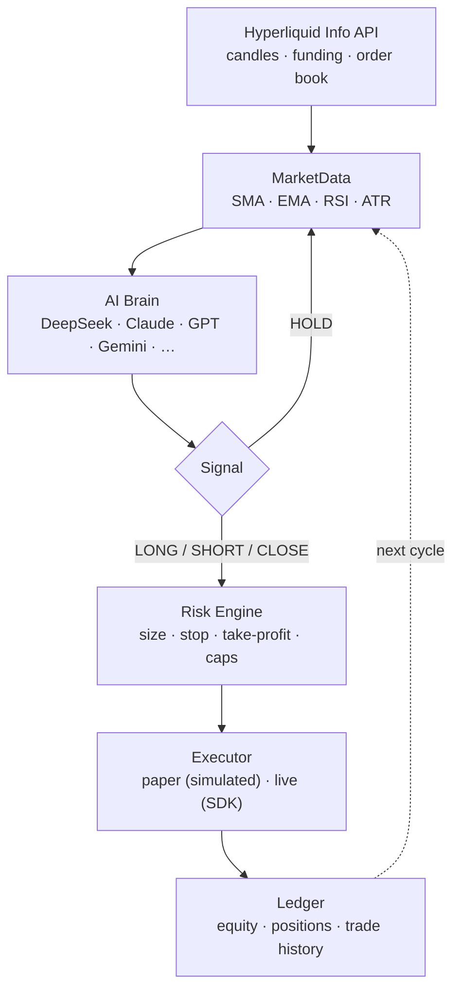
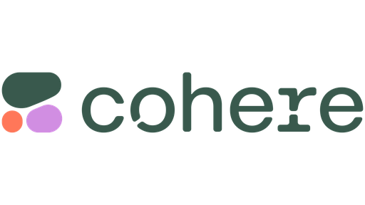
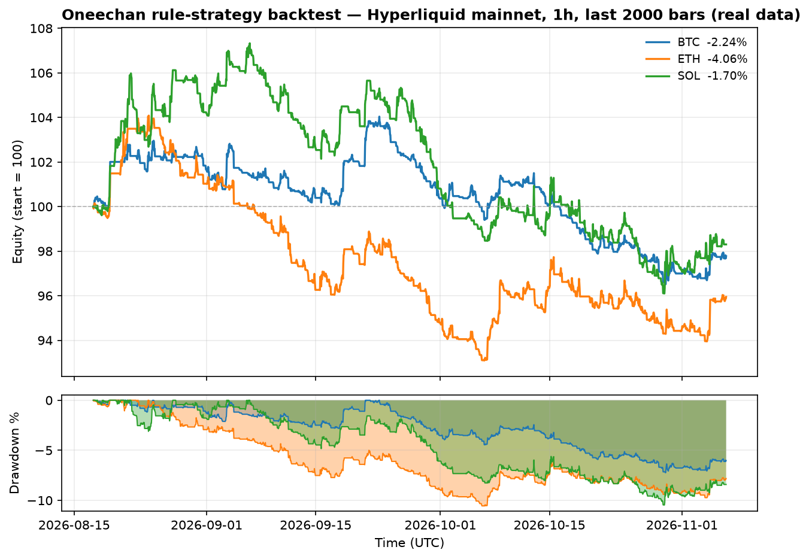

<p align="center">
  
</p>

<h1 align="center">Oneechan</h1>

<p align="center">
  <strong>An AI trading agent for Hyperliquid L1</strong><br>
  DeepSeek · Claude · GPT · Gemini · and more — reads the market, sizes the trade, executes it.<br>
  Paper-first. Multi-provider. Backtested with real data.
</p>

<p align="center">
  <a href="https://oneechan.si"></a>
  <a href="https://x.com/oneechansi"></a>
  <a href="./LICENSE"></a>
  
  
  
</p>

<p align="center">
  <b>English</b> · <a href="README.zh-CN.md">简体中文</a> · <a href="README.ja.md">日本語</a>
</p>

---

## What is Oneechan?

Oneechan is an **AI-powered perpetual-futures trading agent** that runs on
[Hyperliquid L1](https://hyperliquid.xyz). Every decision cycle it:

1. pulls live on-chain market data (candles, funding, order book),
2. asks an LLM — **DeepSeek, Claude, GPT, Gemini, or 9 other providers** — to reason
   over that data and return a structured `LONG / SHORT / CLOSE / HOLD` signal,
3. sizes the position with a **risk engine** (equity-at-risk, stop, max-notional,
   max-leverage caps),
4. executes through the official Hyperliquid SDK — **simulated paper fills by
   default**, real orders only when you explicitly opt in.

It ships with a **backtesting harness** so you can measure any strategy against
real Hyperliquid candles before risking a cent.

> ⚠️ Oneechan is educational software, not financial advice, and **no strategy is
> 100% profitable** (see [Backtesting](#backtesting) and [Disclaimer](#disclaimer)).

---

## How it works



| Stage | What it does |
| --- | --- |
| **MarketData** | Wraps the Hyperliquid `Info` API; computes SMA/EMA/RSI/ATR and book imbalance. Read-only, no keys. |
| **Brain** | Sends a compact context prompt to the configured LLM and parses a strict JSON decision. Anything invalid becomes `HOLD`. |
| **Risk** | Converts a signal into a concrete size: risks `risk_per_trade_pct` of equity to the stop, capped by max notional + max leverage. |
| **Executor** | Paper mode fills at mid with a taker-fee assumption; live mode signs real orders via an **API wallet** (trade-only, no withdraw). |
| **Ledger** | Persists equity, positions and trade history to disk every cycle. |

---

## Features

- **Multi-provider AI** — one interface, 14 providers (DeepSeek, Claude, GPT, Gemini,
  OpenRouter, Groq, xAI, Together, Mistral, Perplexity, Cohere, Fireworks, Cerebras, Qwen).
- **Paper-first** — fully simulated trading out of the box. Zero keys required.
- **Live trading** — real orders on Hyperliquid testnet or mainnet behind an explicit `--mode live`.
- **Risk controls** — confidence-scaled sizing, stop/take-profit, max notional, max leverage, per-coin cooldown.
- **Backtesting** — replays a strategy over real candles and reports honest metrics.
- **Multi-coin** — watch any Hyperliquid perp (BTC, ETH, SOL, …).
- **Thin** — only the Hyperliquid SDK, `openai`, `anthropic`, `eth-account`, `PyYAML`, `python-dotenv`.

---

## Quick start

```bash
# clone
git clone https://github.com/jepspows/oneechan.git
cd oneechan

# create a virtualenv and install
python -m venv .venv
source .venv/bin/activate          # Windows: .venv\Scripts\activate
pip install -r requirements.txt

# (optional) copy and fill in your keys — paper mode needs none
cp .env.example .env
```

**Run in paper mode (no keys, simulated):**

```bash
python main.py --once               # one decision cycle, then exit
python main.py                      # loop every 5 minutes
python main.py --brain mock         # run the pipeline with no LLM at all
python main.py --coins BTC SOL      # override the coin list
```

**Backtest the rule strategy (no keys, real data):**

```bash
python -m oneechan.backtest --coin BTC --interval 1h --bars 720 --network mainnet
python -m oneechan.backtest --coins BTC ETH SOL --save
python sweep.py                     # parameter sweep over BTC/ETH/SOL
```

**Live (real orders — explicit opt-in):**

```bash
python main.py --mode live --network testnet     # testnet first
python main.py --mode live --network mainnet
```

> Live mode reads `HYPERLIQUID_PRIVATE_KEY` from `.env`. Use an **API wallet**
> (https://app.hyperliquid.xyz/API) — it can trade but never withdraw.

---

## AI providers

Set `llm.provider` in `config.yaml` and put the matching key in `.env`.
Model IDs below are examples — use whatever your provider currently offers.

| | Provider | `llm.provider` | Example model | Key |
|--|--|--|--|--|
|  | DeepSeek | `deepseek` | `deepseek-v4-pro` / `deepseek-flash` | `DEEPSEEK_API_KEY` |
|  | Claude | `anthropic` | `claude-sonnet-5-5` / `claude-opus-5-5` | `ANTHROPIC_API_KEY` |
|  | OpenAI | `openai` | `gpt-4o` | `OPENAI_API_KEY` |
|  | Gemini | `gemini` | `gemini-3-flash-preview` | `GEMINI_API_KEY` |
|  | OpenRouter | `openrouter` | `anthropic/claude-sonnet-5-5` | `OPENROUTER_API_KEY` |
|  | Groq | `groq` | `llama-3.3-70b-versatile` | `GROQ_API_KEY` |
|  | xAI | `xai` | `grok-2-latest` | `XAI_API_KEY` |
|  | Together AI | `together` | `meta-llama/Llama-3.3-70B-Instruct-Turbo` | `TOGETHER_API_KEY` |
|  | Mistral AI | `mistral` | `mistral-large-latest` | `MISTRAL_API_KEY` |
|  | Perplexity | `perplexity` | `sonar-pro` | `PERPLEXITY_API_KEY` |
|  | Cohere | `cohere` | `command-r-plus` | `CO_API_KEY` |
|  | Fireworks AI | `fireworks` | `accounts/fireworks/models/llama-v3p3-70b-instruct` | `FIREWORKS_API_KEY` |
|  | Cerebras | `cerebras` | `llama3.3-70b` | `CEREBRAS_API_KEY` |
|  | Qwen | `qwen` | `qwen-max` | `DASHSCOPE_API_KEY` |

---

## Backtesting

The repository includes a backtesting harness (`oneechan/backtest.py`) and a
parameter sweep (`sweep.py`). The chart below is generated from **real Hyperliquid
mainnet data** (1h candles, last 2,000 bars ≈ 83 days) using the built-in trend
strategy at 3% stop / 6% take-profit:

<p align="center">
  
</p>

| Coin | Return | Win rate | Profit factor | Max drawdown | Trades |
| --- | --- | --- | --- | --- | --- |
| BTC | −2.24% | 20.9% | 0.96 | 7.23% | 139 |
| ETH | −4.06% | 19.6% | 0.89 | 10.56% | 148 |
| SOL | −1.70% | 20.0% | 1.00 | 10.46% | 145 |

**These numbers are shown honestly on purpose.** This simple baseline strategy
*loses* money after fees in this window. That is normal — most naive strategies do.
It exists so you have a transparent, reproducible baseline to compare the LLM
brain and your own ideas against.

**Walk-forward (out-of-sample) validation** — `python research.py` sweeps ~100
parameter "patterns" on the past 60% of data, picks the best, then runs it on the
future 40% it never saw. The result is the whole point:

| Coin | Best on the past (curve-fit) | On the future (out-of-sample) |
| --- | --- | --- |
| BTC | +0.27% | **−5.82%** |
| ETH | +16.36% | **−8.01%** |
| SOL | +16.32% | **−11.50%** |

A strategy that looks +16% on the past collapses to −8% on the future. That gap is
overfitting — which is exactly why Oneechan does not and cannot promise profit.

> Regenerate the chart + metrics with: `python scripts/gen_charts.py` (requires `matplotlib`).
> Full methodology in [docs/BACKTESTING.md](docs/BACKTESTING.md).

---

## Configuration

All settings live in `config.yaml`. Defaults are safe and paper-only.

| Key | Default | Meaning |
| --- | --- | --- |
| `agent.mode` | `paper` | `paper` (simulated) or `live` (real orders) |
| `agent.coins` | `["BTC","ETH","SOL"]` | Perps the agent watches |
| `agent.interval` | `1h` | Candle interval fed to the brain |
| `agent.lookback` | `96` | Candles in the context window |
| `agent.cadence_seconds` | `300` | Seconds between cycles |
| `agent.cooldown_seconds` | `3600` | Min seconds between trades per coin |
| `agent.max_position_pct` | `25.0` | Max notional per position, % of equity |
| `agent.max_leverage` | `3` | Max effective leverage |
| `agent.risk_per_trade_pct` | `1.0` | Equity at risk per trade, % |
| `llm.provider` | `deepseek` | Which provider to use |
| `llm.model` | `deepseek-v4-pro` | Provider model ID |
| `llm.base_url` | `""` | Override endpoint (blank = provider default) |
| `hyperliquid.network` | `testnet` | `testnet` or `mainnet` |
| `hyperliquid.address` | `""` | Main wallet address (public) |

---

## Project layout

```
oneechan/
├── main.py                 # CLI entry point
├── config.yaml             # agent + llm + network config
├── sweep.py                # parameter sweep over the rule strategy
├── requirements.txt
├── .env.example            # template (copy to .env)
├── docs/
│   ├── images/             # logo, backtest chart, provider logos
│   └── BACKTESTING.md      # methodology
├── scripts/
│   └── gen_charts.py       # regenerate the backtest chart
└── oneechan/
    ├── config.py           # config loader
    ├── market.py           # Hyperliquid Info wrapper + indicators
    ├── llm.py              # multi-provider LLM abstraction
    ├── brain.py            # signal engine (+ mock fallback)
    ├── risk.py             # position sizing
    ├── state.py            # paper account ledger
    ├── executor.py         # paper / live order placement
    ├── agent.py            # orchestration loop
    └── backtest.py         # backtesting harness
```

---

## Security

- The private key is **only ever read from the environment** — never commit `.env`.
- `.env`, `.venv/`, and `state/` are gitignored.
- Use a dedicated **API wallet** for live trading: it can place/cancel orders but
  **cannot withdraw**, so a leaked key can't drain funds.
- Paper mode needs no key at all.

---

## Disclaimer

Oneechan is educational software. Trading perpetual futures involves substantial
risk of loss. Nothing here is financial advice.

**There is no strategy that is 100% profitable**, and no backtest — however
favourable — guarantees future results. Anyone promising guaranteed profits is not
being honest with you. Always start in paper mode, validate over long periods, and
only run live with money you can afford to lose.

---

## License

[MIT](./LICENSE) © 2026 Oneechan Contributors
