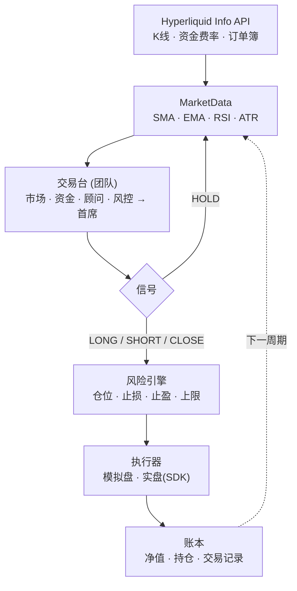
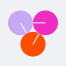
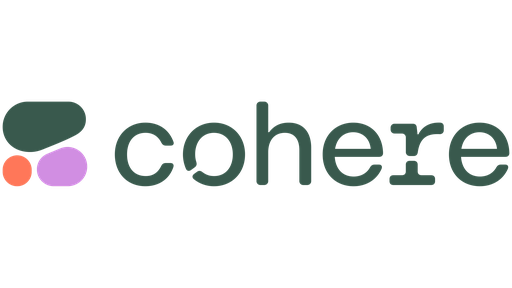
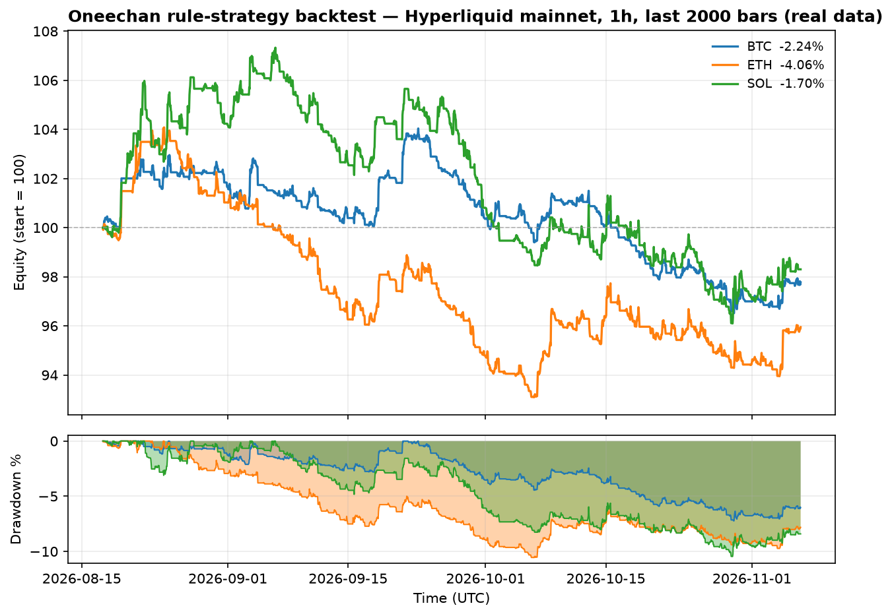

<p align="center">
  
</p>

<h1 align="center">Oneechan</h1>

<p align="center">
  <strong>面向 Hyperliquid L1 的 AI 交易代理</strong><br>
  DeepSeek · Claude · GPT · Gemini · 以及更多 —— 读取市场、计算仓位、执行交易。<br>
  默认模拟盘 · 多模型 · 真实数据回测。
</p>

<p align="center">
  <a href="https://oneechan.si"></a>
  <a href="https://x.com/oneechansi"></a>
  <a href="./LICENSE"></a>
  
  
  
</p>

<p align="center">
  <a href="README.md">English</a> · <b>简体中文</b> · <a href="README.ja.md">日本語</a>
</p>

---

## Oneechan 是什么？

Oneechan 是一个运行在 [Hyperliquid L1](https://hyperliquid.xyz) 上的 **AI 永续合约交易代理**。每个决策周期它会：

1. 拉取链上实时行情（K 线、资金费率、订单簿），
2. 召集一个**交易台** —— 由专业化的 LLM 角色（**市场分析师**、**资金与情绪分析师**、
   **财务顾问**、**风控经理**）各自基于数据推理并提交报告，再由**首席投资组合经理**汇总成
   结构化的 `LONG / SHORT / CLOSE / HOLD` 信号（每个席位由 **DeepSeek、Claude、GPT、Gemini
   或其他 9 家提供商**驱动），
3. 用**风险引擎**计算仓位（按止损风险、最大名义值、最大杠杆设上限）—— 风控经理的上限会作为
   硬性兜底被强制执行，
4. 通过官方 Hyperliquid SDK 执行 —— 默认**模拟盘成交**，只有你明确开启时才下真实订单。

它附带一个**回测框架**，让你在冒任何资金风险之前，用真实的 Hyperliquid K 线评估策略。

> ⚠️ Oneechan 是教学软件，不构成投资建议，而且**没有任何策略能做到 100% 盈利**
> （见[回测](#回测)与[免责声明](#免责声明)）。

---

## 工作原理



| 阶段 | 说明 |
| --- | --- |
| **MarketData** | 封装 Hyperliquid `Info` API；计算 SMA/EMA/RSI/ATR 与订单簿失衡。只读、无需密钥。 |
| **交易台** | 专业化的 LLM 角色（市场分析师、资金与情绪、财务顾问、风控经理）各自返回一份报告，由**首席投资组合经理**汇总成一条严格的 JSON 决策；任何非法结果都按 `HOLD` 处理。 |
| **Risk** | 把信号转成具体仓位：按 `risk_per_trade_pct` 的风险敞口换算，受最大名义值与最大杠杆约束 —— 风控经理的上限作为硬性兜底强制执行。 |
| **Executor** | 模拟盘按中间价 + 手续费估算成交；实盘通过 **API 钱包**（只能交易、不能提现）签名下单。 |
| **Ledger** | 每个周期把净值、持仓、交易记录落盘。 |

---

## 交易台（多智能体团队）

Oneechan 默认是**团队**而不是单一模型。每个周期，最多五个角色分析同一份市场快照，然后由首席汇总：

| 席位 | 职责 | 输出 |
| --- | --- | --- |
| **市场分析师** | 趋势、动量、支撑/阻力 | 方向 · 置信度 · 价位 |
| **资金与情绪分析师** | 资金费率、订单簿失衡、仓位拥挤 | 方向 · 拥挤 · 资金信号 |
| **财务顾问** | 宏观风险环境、风险偏好开/关 | risk_on · 建议杠杆 |
| **风控经理** | 独立、保守，本金保全 | 批准/否决 · 止损/止盈/杠杆上限 |
| **首席投资组合经理** | 汇总所有报告，做出最终决策 | LONG / SHORT / CLOSE / HOLD |

**风控经理的上限会作为硬性兜底强制执行**：即使首席过于激进，杠杆上限、止损下限、止盈上限也会被
钳制，`approve: false` 会直接否决这笔交易。

```yaml
agent:
  team_enabled: true              # 设为 false 则回到单一模型行为
team:
  roles: ["market_analyst", "flow_analyst", "advisor", "risk_manager"]
```

所有席位共用同一个 `llm.provider` / 模型 / 密钥。运行 `python main.py --once --brain mock` 无需
密钥即可查看团队结构，`--no-team` 则切回单一模型。

> ⚠️ 团队提升的是推理质量与风控纪律，并不会让亏损变得**不可能**。
> 请参阅[回测](#回测)与[免责声明](#免责声明)。

---

## 特性

- **交易台（团队）** —— 市场分析师、资金与情绪分析师、财务顾问、风控经理向首席提交报告；
  风控经理拥有一票否决权，并为每笔交易设置上限。
- **多模型 AI** —— 一个接口，14 家提供商（DeepSeek、Claude、GPT、Gemini、OpenRouter、
  Groq、xAI、Together、Mistral、Perplexity、Cohere、Fireworks、Cerebras、Qwen）。
- **默认模拟盘** —— 开箱即用的完全模拟交易，无需任何密钥。
- **实盘交易** —— 通过显式的 `--mode live` 在 Hyperliquid 测试网/主网下真实订单。
- **风控** —— 按置信度缩放仓位、止损/止盈、最大名义值、最大杠杆、单币冷却。
- **回测** —— 用真实 K 线回放策略并输出诚实的指标。
- **多币种** —— 可监控任意 Hyperliquid 永续合约（BTC、ETH、SOL …）。
- **轻量** —— 仅依赖 Hyperliquid SDK、`openai`、`anthropic`、`eth-account`、`PyYAML`、`python-dotenv`。

---

## 快速开始

```bash
git clone https://github.com/jepspows/oneechan.git
cd oneechan

python -m venv .venv
source .venv/bin/activate          # Windows: .venv\Scripts\activate
pip install -r requirements.txt

cp .env.example .env               # 可选：填入密钥；模拟盘无需任何密钥
```

**模拟盘运行（无需密钥）：**

```bash
python main.py --once               # 运行一个决策周期后退出
python main.py                      # 每 5 分钟循环
python main.py --brain mock         # 完全不用 LLM 跑通团队流程
python main.py --no-team            # 单一模型模式（跳过交易台）
python main.py --coins BTC SOL      # 覆盖币种列表
```

**回测规则策略（无需密钥，真实数据）：**

```bash
python -m oneechan.backtest --coin BTC --interval 1h --bars 720 --network mainnet
python -m oneechan.backtest --coins BTC ETH SOL --save
python sweep.py                     # 对 BTC/ETH/SOL 做参数扫描
```

**实盘（真实订单 —— 显式开启）：**

```bash
python main.py --mode live --network testnet     # 先在测试网
python main.py --mode live --network mainnet
```

> 实盘会从 `.env` 读取 `HYPERLIQUID_PRIVATE_KEY`。请使用 **API 钱包**
> （https://app.hyperliquid.xyz/API）—— 它只能交易、无法提现。

---

## AI 提供商

在 `config.yaml` 里设置 `llm.provider`，并把对应密钥填入 `.env`。
下表中的模型 ID 仅为示例，请以你的提供商当前目录为准。

| | 提供商 | `llm.provider` | 示例模型 | 密钥 |
|--|--|--|--|--|
|  | DeepSeek | `deepseek` | `deepseek-v4-pro` / `deepseek-flash` | `DEEPSEEK_API_KEY` |
|  | Claude | `anthropic` | `claude-sonnet-5-5` / `claude-opus-5-5` | `ANTHROPIC_API_KEY` |
|  | OpenAI | `openai` | `gpt-4o` | `OPENAI_API_KEY` |
|  | Gemini | `gemini` | `gemini-3-flash-preview` | `GEMINI_API_KEY` |
|  | OpenRouter | `openrouter` | `anthropic/claude-sonnet-5-5` | `OPENROUTER_API_KEY` |
|  | Groq | `groq` | `llama-3.3-70b-versatile` | `GROQ_API_KEY` |
|  | xAI | `xai` | `grok-2-latest` | `XAI_API_KEY` |
|  | Together AI | `together` | `meta-llama/Llama-3.3-70B-Instruct-Turbo` | `TOGETHER_API_KEY` |
|  | Mistral AI | `mistral` | `mistral-large-latest` | `MISTRAL_API_KEY` |
|  | Perplexity | `perplexity` | `sonar-pro` | `PERPLEXITY_API_KEY` |
|  | Cohere | `cohere` | `command-r-plus` | `CO_API_KEY` |
|  | Fireworks AI | `fireworks` | `accounts/fireworks/models/llama-v3p3-70b-instruct` | `FIREWORKS_API_KEY` |
|  | Cerebras | `cerebras` | `llama3.3-70b` | `CEREBRAS_API_KEY` |
|  | Qwen | `qwen` | `qwen-max` | `DASHSCOPE_API_KEY` |

---

## 回测

仓库自带回测框架（`oneechan/backtest.py`）与参数扫描（`sweep.py`）。下面这张图是用
**真实的 Hyperliquid 主网数据**（1h K 线、最近 2,000 根 ≈ 83 天），用内置趋势策略在
3% 止损 / 6% 止盈下生成的：

<p align="center">
  
</p>

| 币种 | 收益 | 胜率 | 盈亏比 | 最大回撤 | 交易次数 |
| --- | --- | --- | --- | --- | --- |
| BTC | −2.24% | 20.9% | 0.96 | 7.23% | 139 |
| ETH | −4.06% | 19.6% | 0.89 | 10.56% | 148 |
| SOL | −1.70% | 20.0% | 1.00 | 10.46% | 145 |

**这些数字是刻意如实展示的。** 这个简单的基线策略在扣费后是*亏钱*的。这很正常 ——
大多数朴素策略都会亏钱。它的存在是为了给你一个透明、可复现的基线，用来对比 LLM 大脑
和你自己的想法。

> 重新生成图表与指标：`python scripts/gen_charts.py`（需要 `matplotlib`）。
> 完整方法见 [docs/BACKTESTING.md](docs/BACKTESTING.md)。

---

## 配置

所有设置都在 `config.yaml` 中，默认值安全且仅模拟盘。

| 键 | 默认值 | 含义 |
| --- | --- | --- |
| `agent.mode` | `paper` | `paper`（模拟）或 `live`（真实订单） |
| `agent.coins` | `["BTC","ETH","SOL"]` | 代理监控的合约 |
| `agent.interval` | `1h` | 喂给大脑的 K 线周期 |
| `agent.lookback` | `96` | 上下文窗口内的 K 线数 |
| `agent.cadence_seconds` | `300` | 周期间隔（秒） |
| `agent.cooldown_seconds` | `3600` | 单币最小交易间隔（秒） |
| `agent.max_position_pct` | `25.0` | 单仓最大名义值（净值 %） |
| `agent.max_leverage` | `3` | 最大有效杠杆 |
| `agent.risk_per_trade_pct` | `1.0` | 每笔风险敞口（净值 %） |
| `agent.team_enabled` | `true` | 运行多智能体交易台（`false` = 单一模型） |
| `team.roles` | `[market_analyst, flow_analyst, advisor, risk_manager]` | 首席之前运行的专家席位（首席始终运行） |
| `llm.provider` | `deepseek` | 使用的模型提供商 |
| `llm.model` | `deepseek-v4-pro` | 提供商模型 ID |
| `llm.base_url` | `""` | 覆盖端点（留空 = 提供商默认） |
| `hyperliquid.network` | `testnet` | `testnet` 或 `mainnet` |
| `hyperliquid.address` | `""` | 主钱包地址（公开） |

---

## 安全

- 私钥**只从环境变量读取** —— 永远不要提交 `.env`。
- `.env`、`.venv/`、`state/` 已在 `.gitignore` 中。
- 实盘请使用专用 **API 钱包**：它能下单/撤单，但**无法提现**，即使密钥泄露也无法转走资金。
- 模拟盘完全不需要任何密钥。

---

## 免责声明

Oneechan 是教学软件。永续合约交易存在重大亏损风险。本文不构成投资建议。

**没有任何策略能做到 100% 盈利**，无论回测多么漂亮都不保证未来收益。任何承诺保本保收益
的人都没有对你说实话。请始终从模拟盘开始，长期验证，并且只用亏得起的钱做实盘。

---

## 许可证

[MIT](./LICENSE) © 2026 Oneechan Contributors
